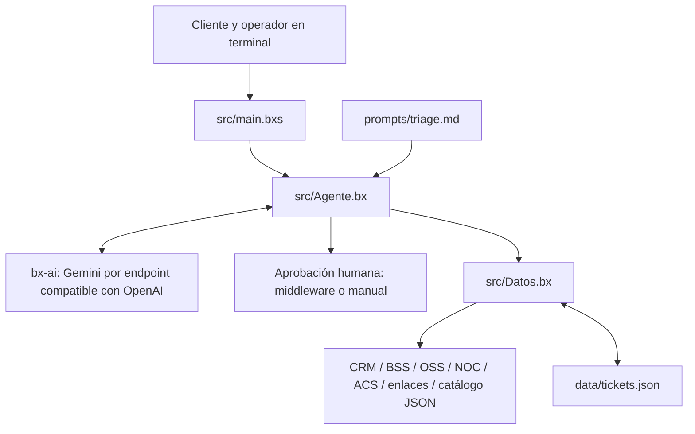

# HELP! — Agente de soporte para un ISP de fibra

Prototipo de un asistente de soporte en español para un proveedor de internet por fibra óptica (FTTH), con clientes residenciales y corporativos de El Salvador. Usa **BoxLang**, **BoxLang AI (`bx-ai`)** y **Gemini** para conversar por terminal, consultar evidencia técnica, orientar al cliente y gestionar tickets.

Los sistemas del ISP se simulan con archivos JSON: CRM, facturación, monitoreo de ONT, incidentes del NOC, WiFi del hogar y enlaces dedicados. Los datos son ficticios. Los reinicios y las visitas son simulaciones; el agente sí persiste los tickets en disco.

## Qué hace

El flujo definido en [el prompt de triage](prompts/triage.md) identifica al cliente por DUI, NIT o factura; consulta facturación, incidentes del PON y estado de la ONT; y luego revisa WiFi o el enlace corporativo según corresponda. Contrasta el diagnóstico con un catálogo de 18 fallas, propone pruebas caseras y crea, actualiza, escala o cierra tickets cuando corresponde.

Incluye aprobación humana (**HITL**, human in the loop) para reiniciar una ONT, agendar una visita y cerrar un ticket. La creación de tickets bloquea en código los servicios suspendidos por mora y las masivas activas, y reutiliza un ticket existente si el cliente ya tiene uno sin cerrar.

## Arquitectura



| Componente | Responsabilidad |
|---|---|
| `src/main.bxs` | Bucle del chat, comandos de terminal y manejo de errores. |
| `src/Agente.bx` | Construye el agente, registra 14 herramientas, controla el cliente identificado y aplica guardas de negocio y aprobación. |
| `src/Datos.bx` | Lee configuración y datos, busca clientes y fallas, simula reinicios y escribe tickets. |
| `prompts/triage.md` | Orden de diagnóstico, reglas de conversación, seguimiento y escalamiento. |
| `data/` | Sistemas simulados y persistencia de tickets. |
| `docs/CONTRATOS.md` | Contratos de datos, áreas, prioridades y formato de tickets. |
| `tests/validar_datos.bxs` | Validación determinista de consistencia y diagnósticos de los datos. |
| `tests/casos_esperados.*` | Guiones y respuestas esperadas; no se cargan en el agente. |
| `smoke.bxs` | Prueba aislada de conexión con Gemini y llamada a una herramienta. |

La implementación disponible cubre **CAPA 0** (datos y validación) y **CAPA 1** (agente por CLI). Las referencias a Telegram, portal corporativo y CAPA 4 describen extensiones previstas: no hay un bot de Telegram ni un servidor web implementados en este repositorio.

### Modelo, herramientas y memoria

Gemini se utiliza mediante el proveedor `openai-compatible`, con URL `https://generativelanguage.googleapis.com/v1beta/openai`. Un middleware elimina `additionalProperties` del esquema de herramientas antes de enviarlo y muestra ciertos errores del proveedor. El código señala esta adaptación como solución a problemas de tool calling del proveedor nativo de Gemini en `bx-ai` 3.5.

Cada agente mantiene una ventana de hasta **40 mensajes** en memoria. Las herramientas son:

- Identificación y consultas: `identificar_cliente`, `facturacion`, `incidentes_pon`, `estado_ont`, `wifi_hogar`, `enlace_corporativo`, `buscar_kb`.
- Tickets: `crear_ticket`, `consultar_ticket`, `actualizar_ticket`, `escalar_ticket`, `cerrar_ticket`.
- Acciones simuladas: `reiniciar_ont`, `agendar_visita`.

Las consultas de datos de cliente y las operaciones sobre sus tickets validan su pertenencia al cliente identificado en la conversación. La búsqueda en la base de conocimiento es general.

### Sistemas simulados

| Archivo | Contenido |
|---|---|
| `crm_clientes.json` | Identidad, tipo de cliente, plan, PON y serial de ONT. |
| `bss_facturacion.json` | Cuentas, facturas, mora, canales de pago y regla de reconexión. |
| `oss_ont.json` | Estado óptico, WAN, eventos y estados de simulación posteriores al reinicio. |
| `noc_incidentes.json` | Incidentes y resumen de ONT por PON. |
| `acs_wifi.json` | Bandas, canales, utilización, dispositivos y pruebas de velocidad residenciales. |
| `corp_enlaces.json` | VLAN, BGP, CPE, métricas y SLA de enlaces corporativos. |
| `catalogo_fallas.json` | 18 fallas, indicadores, pruebas, resolución, umbrales, áreas y prioridades. |
| `tickets.json` | Tickets con historial, visitas, acciones y ficha de escalamiento. |

Todos estos archivos están en `data/`. Los tiempos relativos del NOC se convierten a fechas usando la hora del equipo al consultar; no hay un reloj de simulación que avance los incidentes.

## Requisitos

- Java **21 o posterior**, BoxLang OS/CLI y el módulo `bx-ai`, según los [requisitos oficiales de BoxLang AI](https://github.com/ortus-boxlang/bx-ai).
- Git para clonar el repositorio.
- Una clave de API de Gemini y acceso a internet para el chat y la prueba de humo.
- Permiso de escritura en `data/tickets.json` y en el directorio de trabajo del runtime de BoxLang.

El repositorio no fija versiones mediante un manifiesto de dependencias. El comentario sobre `bx-ai` 3.5 describe el contexto del código, pero no constituye un bloqueo de versión.

## Instalación

Los siguientes métodos proceden de la [instalación oficial de BoxLang](https://boxlang.io/download). Si ya tienes Java y BoxLang, pasa a la instalación del módulo.

### Linux

Instala Git y Java 21 con el gestor de paquetes de tu distribución. Por ejemplo, en Ubuntu con esos paquetes disponibles:

```bash
sudo apt update
sudo apt install git curl openjdk-21-jdk
/bin/bash -c "$(curl -fsSL https://install.boxlang.io)"
```

Abre una terminal nueva si el instalador modifica el `PATH`.

### macOS

Con Homebrew instalado:

```bash
brew install git openjdk@21
brew tap ortus-boxlang/boxlang
brew install ortus-boxlang/boxlang/boxlang
install-boxlang
```

Sigue las indicaciones de Homebrew para que Java 21 quede disponible en el `PATH` y, si corresponde, en `JAVA_HOME`.

### Windows

Instala Git y un JDK 21 o posterior. En PowerShell ejecuta el instalador oficial:

```powershell
powershell -NoExit -Command "iex ((New-Object System.Net.WebClient).DownloadString('https://install-windows.boxlang.io'))"
```

También puedes usar el instalador de Windows de la [página de descargas](https://boxlang.io/download). Abre una terminal nueva al terminar.

### Módulo y repositorio — todos los sistemas

Comprueba Java, instala `bx-ai` para el runtime de CLI y descarga el proyecto:

```text
java -version
install-bx-module bx-ai
git clone https://github.com/fbclabs/help-isp-agent.git
cd help-isp-agent
```

La instalación del módulo está documentada en el [repositorio oficial de BoxLang AI](https://github.com/ortus-boxlang/bx-ai). No necesitas un servidor web ni CommandBox para ejecutar los scripts de este proyecto con BoxLang OS.

## Configuración

Desde la raíz del proyecto, crea `.env` a partir de la plantilla.

Linux y macOS:

```bash
cp .env.example .env
```

Windows, PowerShell:

```powershell
Copy-Item .env.example .env
```

Edita `.env` con tu clave:

```dotenv
GEMINI_API_KEY=TU_CLAVE_REAL
GEMINI_MODEL=gemini-2.5-flash
HITL_MODO=middleware
```

| Variable | Uso | Predeterminado en el agente |
|---|---|---|
| `GEMINI_API_KEY` | Clave de acceso a Gemini. | Vacío; debes configurarla. |
| `GEMINI_MODEL` | Identificador del modelo que se solicita al proveedor. | `gemini-2.5-flash` |
| `HITL_MODO` | `middleware` para aprobación mediante `bx-ai`, o `manual` para preguntar dentro de la herramienta. | `middleware` |

Estos modelos son los valores de la plantilla y del código; su disponibilidad y cuota dependen de tu cuenta. Puedes configurar otro modelo compatible con llamadas a herramientas.

En el agente, la precedencia es **variable de entorno no vacía → `.env` no vacío → valor predeterminado**. El lector de `.env` admite líneas simples `CLAVE=VALOR` y comentarios en líneas que comienzan con `#`; escribe los valores sin comillas ni comentarios al final. `.env` está excluido de Git.

Usa exclusivamente `middleware` o `manual` para `HITL_MODO`: el código no valida otros valores y un valor distinto evita ambos mecanismos de aprobación. En modo manual, el operador aprueba con `s` o `si`; cualquier otra respuesta rechaza la acción. En modo middleware, sigue el diálogo que presenta `bx-ai`.

`smoke.bxs` tiene su propio lector: la clave de `.env` tiene prioridad sobre la del sistema y el modelo se toma de `.env` o del valor predeterminado. Si pruebas con variables del sistema, ten en cuenta esa diferencia.

## Ejecución

Ejecuta los comandos **desde la raíz del repositorio**:

```text
boxlang tests/validar_datos.bxs
boxlang smoke.bxs
boxlang src/main.bxs
```

El validador de datos no utiliza IA ni requiere clave de Gemini. La prueba de humo y el chat sí hacen solicitudes al proveedor y consumen cuota.

En la terminal del chat puedes escribir, por ejemplo:

```text
Cliente> Mi DUI es 09901004-9.
Cliente> El internet está bien lento en la noche, sobre todo en los celulares.
```

El agente debería identificar a Carlos Ernesto Martínez, consultar sus datos y relacionar la lentitud con la saturación de WiFi de 2.4 GHz. Las trazas `[TOOL]` permiten observar qué herramientas ejecutó.

| Comando del chat | Efecto |
|---|---|
| `/nuevo` | Crea un agente nuevo y descarta la memoria y el cliente identificado de la conversación anterior. |
| `/tickets` | Muestra todos los tickets del archivo local; es un comando del operador. |
| `salir`, `exit`, `quit` | Termina la sesión. |

El reinicio simulado modifica la ONT solo en la memoria de `Datos`; no escribe `oss_ont.json`. `/nuevo` reutiliza esa instancia de datos, por lo que conserva el cambio durante el proceso. Para recuperar el estado original de la ONT, sal y vuelve a ejecutar el programa. Los tickets permanecen en disco entre ejecuciones.

## Los 12 clientes de prueba

Hay **8 residenciales y 4 corporativos**. Todos son ficticios; los DUI/NIT respetan el formato, pero no tienen dígitos verificadores reales. Para identificarte, introduce el documento o la factura de la tabla; los códigos `CLI-*` y `CORP-*` son identificadores internos y no se aceptan como dato de identificación.

| Cliente | Nombre o razón social ficticia | Identificar con | Falla esperada | Área / prioridad | Ticket / visita |
|---|---|---|---|---|---|---|
| CLI-1001 | María Elena Rivas | DUI `09901001-4` | R01: masiva del PON | NOC / P2 | Sin ticket individual ni visita |
| CLI-1002 | José Antonio Hernández | Factura `FAC-2026-100209` | R02: energía o adaptador de ONT | Soporte / P2 | Ticket y visita aprobada |
| CLI-1003 | Ana Lucía Martínez | DUI `09901003-0` | R03: señal óptica degradada | Campo / P3 | Ticket y visita aprobada |
| CLI-1004 | Carlos Ernesto Martínez | DUI `09901004-9` | R06: saturación de WiFi 2.4 GHz | Soporte_Hogar / P4 | Ticket opcional, sin visita |
| CLI-1005 | Rosa María López | Factura `FAC-2026-100509` | R05: suspensión por mora | Facturacion / P4 | Sin ticket técnico ni visita |
| CLI-1006 | Luis Alberto Flores | DUI `09901006-5` | R04: pérdida de señal individual | Campo / P2 | Ticket y visita aprobada |
| CLI-1007 | Karla Patricia Ramírez | DUI `09901007-3` | R08: sesión WAN caída | Soporte / P2 | Ticket, reinicio y cierre aprobados |
| CLI-1008 | Daniel Eduardo Pérez | Factura `FAC-2026-100810` | R07: cobertura WiFi insuficiente | Soporte_Hogar / P4 | Ticket opcional, sin visita |
| CORP-2001 | Logística Volcán Azul, S.A. de C.V. | NIT `0614-150515-901-1` | C01: corte de última milla | Campo / P1 | Ticket, escalamiento y visita aprobada |
| CORP-2002 | Grupo Financiero Cuscatlán Digital, S.A. | NIT `0614-020318-902-3` | C02: BGP caído | Soporte_Corporativo / P1 | Ticket, sin visita |
| CORP-2003 | Centro de Contacto Pacífico, S.A. de C.V. | NIT `0614-110720-903-5` | C04: enlace saturado | Soporte_Corporativo / P3 | Ticket, sin visita |
| CORP-2004 | Clínica Integral Los Almendros | Factura `FAC-2026-200410` | C03: VLAN incorrecta en CPE | Soporte_Corporativo / P1 | Ticket, sin visita |

Los síntomas, valores de evidencia, herramientas y respuestas esperadas están en [tests/casos_esperados.md](tests/casos_esperados.md) y [tests/casos_esperados.json](tests/casos_esperados.json). Usa `/nuevo` entre clientes y responde a las pruebas caseras que proponga el agente. Para CLI-1002, el guion supone que la ONT tampoco enciende en otro tomacorriente; la visita corresponde después de esa comprobación. El cierre de CLI-1003 requiere confirmar la reparación.

### Verificación

`tests/validar_datos.bxs` comprueba lectura de JSON, relaciones entre sistemas, documentos y facturas duplicados, correspondencia de PON/serial y que cada cliente produzca exactamente una falla coincidente con el caso esperado. Si todo coincide, imprime:

```text
CAPA 0 LISTA: datos válidos y cada cliente lleva a una sola falla.
```

Revisa el texto completo: el script imprime errores de validación, pero no establece expresamente un código de salida distinto de cero para ellos. Esta prueba verifica los datos mediante reglas fijas; no comprueba la conversación ni las decisiones de Gemini.

`smoke.bxs` debe mostrar una llamada `[TOOL] estado_ont( CLI-1001 )` y una respuesta que mencione **-19.5 dBm**. Es una herramienta aislada con una respuesta fija, no una lectura del OSS del cliente.

El catálogo también contiene R09, R10, R11, C05, C06 y C07, sin clientes asignados en los 12 casos. Para agregar escenarios, mantén consistentes los JSON correspondientes y añade su caso esperado si deseas validarlos con el script actual.

## Problemas frecuentes

| Síntoma | Qué revisar |
|---|---|
| `boxlang` o `install-bx-module` no se reconoce | Instalación de BoxLang y `PATH`; abre una terminal nueva. |
| Java no se encuentra o tiene una versión antigua | `java -version`, `PATH` y `JAVA_HOME`; usa Java 21 o posterior. |
| No se encuentra `bxModules.bxai` o `aiAgent` | Instala `bx-ai` en el runtime que ejecuta el comando. |
| Falta `GEMINI_API_KEY` | Archivo `.env` en la raíz o variable de entorno; reemplaza el valor de ejemplo. |
| Error 429 | Revisa cuota del proveedor y espera antes de reintentar. La plantilla propone `gemini-2.5-flash-lite` como alternativa, sujeto a disponibilidad y cuota propias. |
| Errores al leer JSON o guardar tickets | Ejecuta desde la raíz, valida los JSON y revisa permisos de escritura. |
| Un caso reutiliza un ticket anterior | Los tickets persisten y el agente busca uno sin cerrar para ese cliente. Usa un respaldo o una copia separada del proyecto para pruebas limpias. |

## Limitaciones

- **Prototipo con datos estáticos:** no hay integraciones reales con CRM, BSS, OSS, TR-069, NOC, agenda de técnicos ni notificaciones a las áreas. Escalar registra una ficha local; agendar genera una orden simulada.
- **Dependencia del modelo:** el chat requiere internet, clave y cuota. Las respuestas y el orden efectivo de herramientas pueden variar. El código no implementa reintentos automáticos para errores del proveedor.
- **Reglas parcialmente declarativas:** el prompt prescribe evitar tickets durante mantenimientos activos y reiniciar solo con condiciones técnicas adecuadas; no todas esas reglas tienen una guarda equivalente en código. La guarda de facturación bloquea `suspendido`, no cualquier cuenta en mora.
- **Identificación sin autenticación:** conocer un DUI, NIT o factura permite seleccionar al cliente. No hay verificación de identidad, roles ni control de acceso para un despliegue público. `/tickets` expone todos los tickets al operador local.
- **Aprobación dependiente del modo:** usa los dos valores admitidos de `HITL_MODO`. En modo middleware, la decisión se toma antes de ejecutar la herramienta; el registro detallado de rechazos implementado dentro de las herramientas corresponde al modo manual.
- **Persistencia simple:** los tickets se reescriben como un único JSON, sin bloqueo, transacciones ni control de concurrencia. El identificador se calcula con la cantidad de tickets más uno, lo que puede producir duplicados si se eliminan registros o ejecutan varios procesos.
- **Memoria temporal:** no se guarda el historial conversacional. La ventana es de 40 mensajes; los datos simulados se cargan al iniciar y los cambios externos no se recargan automáticamente, salvo los tickets.
- **Agenda aproximada:** las visitas usan plazos P1/P2/P3/P4 de 4/24/48/72 horas y una fecha calculada; no comprueban disponibilidad, días hábiles ni cumplimiento real de SLA. Las fechas usan la zona horaria del runtime.
- **Validación limitada:** no hay una suite automatizada de conversaciones ni una matriz de compatibilidad por sistema operativo; tampoco versiones de dependencias fijadas.
- **Canales pendientes:** solo está implementada la terminal; no hay interfaz web, Telegram ni portal corporativo operativo.

## Créditos y licencia

- **Proyecto:** [fbclabs/help-isp-agent](https://github.com/fbclabs/help-isp-agent). El historial Git disponible atribuye la implementación inicial de las capas 0 y 1 y la prueba de humo a **fercho**.
- **Runtime y herramientas de IA:** [BoxLang](https://boxlang.io/) y [BoxLang AI](https://github.com/ortus-boxlang/bx-ai), de Ortus Solutions y sus colaboradores.
- **Modelo de lenguaje:** Gemini, de Google, mediante su endpoint compatible con OpenAI.
- **Datos de demostración:** fixtures ficticios del repositorio, descritos en [docs/CONTRATOS.md](docs/CONTRATOS.md); las IP usan rangos de documentación.

El repositorio no incluye un archivo `LICENSE`. Los términos de uso de BoxLang, `bx-ai` y Gemini corresponden a sus respectivos proveedores; no se debe inferir una licencia para este proyecto a partir de sus dependencias.
